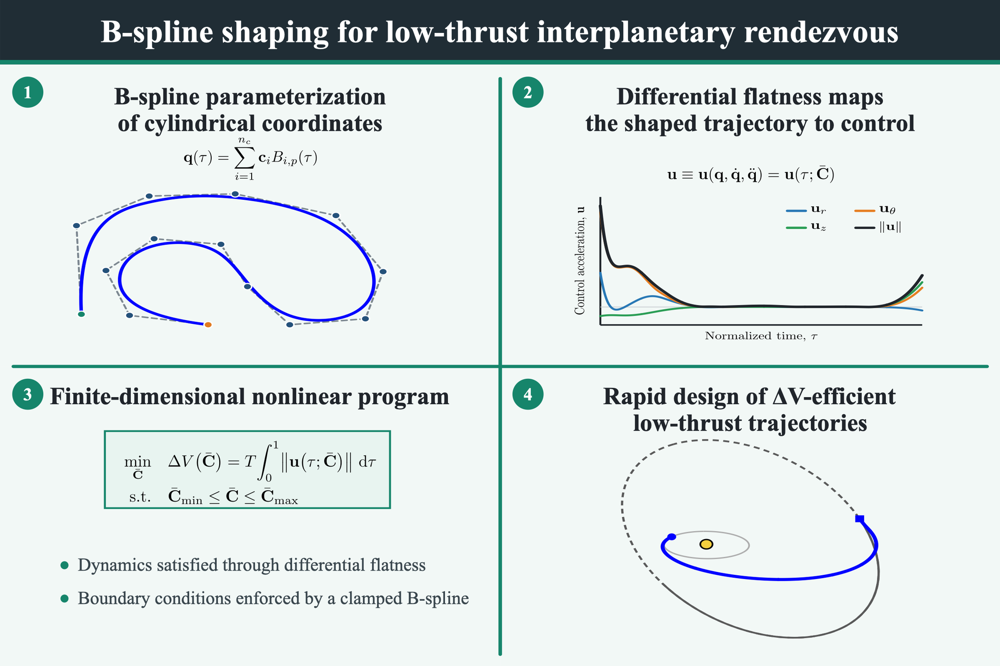

# BSPLINETRANSFER

BSPLINETRANSFER contains the Gondelach vs cylindrical B-spline comparison workflow
used for the paper *B-spline shaping for low-thrust interplanetary rendezvous*,
including grid campaigns, saved-solution postprocessing, and single-transfer
examples.



## Single-Transfer Notebook

[`notebooks/simple_mars_trajectory_examples.ipynb`](notebooks/simple_mars_trajectory_examples.ipynb)
solves one fixed Earth-to-Mars transfer with no departure-date or transfer-time
grid. It compares the high-order Gondelach hodographic method, a 10-control-point
quintic cylindrical B-spline, and a single-segment degree-nine Bézier
parametrization that also uses 10 control points, then plots each trajectory and
thrust-control history.

[`notebooks/mercury_quick_porkchop.ipynb`](notebooks/mercury_quick_porkchop.ipynb)
provides a fast Mercury porkchop demonstration. It evaluates a deliberately
coarse `10 x 10` departure/TOF grid over one Earth-Mercury synodic period and
compares the high-order hodographic, quintic B-spline, and degree-nine Bézier
solutions.

Both notebooks compare the shapes at an equal number of control points rather
than at an equal polynomial degree. A single Bézier segment satisfies
`n_ctrl = degree + 1`, so matching the 10-control-point B-spline requires degree
nine; matching its quintic degree instead would leave only two free control
points after the endpoint elimination and roughly doubles the resulting Delta V.
A Bézier curve also spans a single knot interval, so the composite
Gauss-Legendre objective quadrature places `quadrature_order` nodes over the
whole transfer instead of over each B-spline span. The notebooks therefore raise
the Bézier `quadrature_order` to 30, matching the published campaign settings.

The notebook uses the built-in Keplerian ephemeris so it works without the
external SPICE binary kernels (see [`kernels/README.md`](kernels/README.md)
for how to download them before any `--ephemeris spice` run):

```bash
python -m pip install -r requirements-notebook.txt
jupyter lab notebooks/simple_mars_trajectory_examples.ipynb
```

## Pythagorean 3D thrust certificate

The quadratic 3D demonstration optimizes clamped B-splines for the four
Pythagorean primitives `(h, p, q, theta)`. With five control points and degree
two it has three spans and one free control point per primitive after endpoint
position and velocity elimination:

```bash
python -m optimizer.pythagorean_3d_bernstein \
  --ephemeris spice \
  --departure-date 2028-06-24 \
  --tof-days 460 \
  --spice-target-name "MARS BARYCENTER" \
  --n-rev 1 \
  --degree 2 \
  --n-ctrl 5 \
  --mode min-peak \
  --output output/pythagorean_3d_mars_deg2_nctrl5 \
  --show-plots \
  --quiet
```

Each run saves `solution.json`, `trajectory.csv`, the combined
`pythagorean_3d_solution.png`/`.pdf` trajectory-and-control figure, individual plots,
`pythagorean_3d_attempts.csv`, `comparison_summary.csv`, and
`pythagorean_3d_control_points.npz`. The NPZ stores both initial and optimized
primitive control points together with knots, configuration, convergence, and
reference-metric metadata. In `min-peak` mode the acceleration limit is the
optimized result and `--u-max` must be omitted; the squared peak variable and
the certificate coefficients are made dimensionless with the Bernstein peak
bound of the seed trajectory instead. In `energy` mode, `--u-max` is required
and acts as a fixed acceleration cap.

The min-peak certificate is a degree-80 Bernstein form (degree three, ten
control points) whose coefficients are active to about `1e-10` at the optimum,
so IPOPT reaches different nearby stationary points depending on where the
squared peak starts. `--peak-init-factor` (default `1.05`) sets that starting
value as a multiple of the seed bound; on the Mars case above the returned peak
moves between 0.2973 and 0.3066 mm/s^2 across factors from 1.001 to 20, and
some factors hit the iteration limit. Treat a single solve as an upper bound
and sweep the factor when the peak itself is the reported quantity.

### B-spline Delta-V to Sundman continuation

`optimizer/optimizers.py` connects the nominal minimum-Delta-V cylindrical
B-spline solver to the Pythagorean Sundman solver. It solves the B-spline first,
computes the Sundman coordinate `s(t) = integral(dt/R)`, fits `(h,p,q,theta)`
while preserving the endpoint states exactly, and uses the B-spline peak
acceleration to initialize the Sundman peak variable:

```bash
python -m optimizer.optimizers \
  --ephemeris spice \
  --departure-date 2028-06-24 \
  --tof-days 460 \
  --spice-target-name "MARS BARYCENTER" \
  --n-rev 1 \
  --quiet
```

Add `--prepare-only` to write the fitted continuation seed without running the
second optimization. The output directory contains
`pythagorean_sundman_seed.json`, the source B-spline arrays, and—unless preparation
only was requested—the normal Sundman solution artifacts.

The Sundman solver also provides a hybrid endpoint formulation. Theta and its
rate remain analytically eliminated, while the endpoint controls of `h,p,q`
are free and physical `rho,z,rho_dot,z_dot` conditions are imposed as nonlinear
equalities. Endpoint gauge normalization fixes `p^2 + q^2 = 1` but leaves its
derivative free:

```bash
python -m optimizer.optimizers \
  --pythagorean-mode min-peak \
  --endpoint-formulation physical-equality \
  --quiet
```

Use `--endpoint-formulation primitive-elimination` for the original fully
eliminated primitive endpoint conditions.

## Active Scenario

Run the four kept comparison cases:

```bash
python experiments/compare_gondelach_fig2_fig3_bspline10.py --case mars --dep-step 20 --tof-step 20
python experiments/compare_gondelach_fig2_fig3_bspline10.py --case tempel1 --dep-step 20 --tof-step 20
python experiments/compare_gondelach_fig2_fig3_bspline10.py --case 1989ml --dep-step 20 --tof-step 20
python experiments/compare_gondelach_fig2_fig3_bspline10.py --case mercury --dep-step 20 --tof-step 20
```

Redraw the saved high-order Gondelach vs B-spline plots without rerunning the optimizers:

```bash
python experiments/postprocess_compare_gondelach_plots.py --case mars
```

The post-processed porkchops use calendar departure date on the x-axis and transfer time in years on the y-axis.

Run an additional B-spline variant in the same kept output folder, reusing the cached Gondelach grids and leaving the existing `bspline10` files untouched:

```bash
python experiments/run_bspline_variant_analysis.py --case mars --bspline-n-ctrl 12 --bspline-degree 5 --bspline-workers 4 --progress
```

Run a single-segment Bézier variant by specifying its control-point count.
The degree is inferred as `n_ctrl - 1`, so ten control points produce a
degree-nine Bézier curve. Output artifacts use a
`bezier_nctrl10_deg9_<run-id>` prefix:

```bash
python experiments/run_bspline_variant_analysis.py --case 1989ml --bezier-n-ctrl 10 --quadrature-order 30 --workers 4 --progress
```

Variant artifacts include a deterministic configuration run ID, for example
`bspline_nctrl12_deg5_a1b2c3d4_attempts.csv`. This prevents runs with different
solver settings from sharing a cache. Postprocessing accepts `12:5` when only
one matching run exists, or `12:5:a1b2c3d4` to select an explicit run.

Publication Pareto plots can combine multiple B-spline variants. By default, the postprocessor includes `10:3` and `10:5` when those cached files exist:

```bash
python experiments/postprocess_compare_gondelach_plots.py --case mars --figure-format pdf --no-plot-best-profiles
```

After generating a future 40-control-point case, include it explicitly:

```bash
python experiments/postprocess_compare_gondelach_plots.py --case mars --figure-format pdf --no-plot-best-profiles --pareto-bspline-variants 10:3 10:5 40:5
```

The kept output folders are:

```text
output/compare_gondelach_mars_bspline10_dep20d_tof20d/
output/compare_gondelach_tempel1_bspline10_dep20d_tof20d/
output/compare_gondelach_1989ml_bspline10_dep20d_tof20d/
output/compare_gondelach_mercury_bspline10_dep20d_tof20d/
```

Large Sundman continuation grids archive their per-run `trajectory.csv` files
after the grid completes. Each `dep_*/N*` group has a `trajectories_N*.zip` in
its departure directory; older `dep_*/tof_*/N*` grids use one
`trajectories.zip` per departure. The solution JSON, B-spline NPZ, selection files,
logs, and grid summaries remain in place so the grid can resume normally.
`experiments/plot_bspline_vs_sundman_profiles.py` reads either a loose CSV or
its archived copy. Use `--keep-trajectory-csv` on
`experiments/run_sundman_continuation_grid.py` to retain loose trajectories.
To compact an existing grid, run:

```bash
python -m experiments.compact_grid_trajectories output/<grid-name>
```

The compactor verifies each ZIP before removing its source CSVs and skips
groups with files modified in the past hour by default. Archived CSVs can be
restored with standard ZIP tools if another script needs their original paths.

## Active Layout

```text
BSPLINETRANSFER/
├── experiments/
│   ├── compare_gondelach_fig2_fig3_bspline10.py
│   ├── postprocess_compare_gondelach_plots.py
│   ├── reproduce_gondelach_fig2.py
│   ├── reproduce_gondelach_fig2_bspline_cylindrical.py
│   └── reproduce_gondelach_fig3.py
├── optimizer/
│   ├── canonical_units.py
│   ├── helpers_Bspline.py
│   ├── oneill_nelder_mead.py
│   ├── optimization_Bspline_freetf.py
│   ├── orbit_utils.py
│   └── targets.py
├── notebooks/
│   ├── mercury_quick_porkchop.ipynb
│   └── simple_mars_trajectory_examples.ipynb
├── utils/
└── output/
```

## Dependencies

```bash
pip install -r requirements.txt
```

Core runtime dependencies are NumPy, SciPy, CasADi, and Matplotlib.

## Optimizer Scope

The public `optimizer/` directory contains only the cylindrical B-spline
implementation and the supporting units, orbit, target, and O'Neill
Nelder-Mead modules used for the experiments in *B-spline shaping for
low-thrust interplanetary rendezvous*. Exploratory Radau and indirect
optimizers are not part of the public repository.
